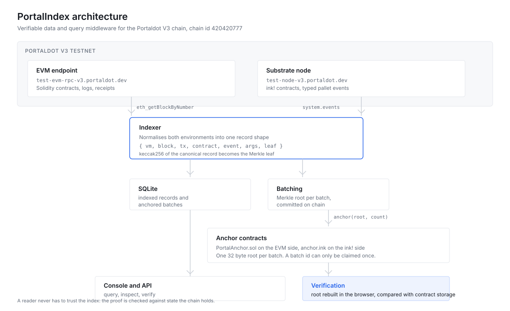

# PortalIndex

Verifiable data and query middleware for the Portaldot V3 chain.

Portaldot V3 runs the same chain in two execution environments: ink!/WASM contracts through
`pallet_contracts`, and Solidity contracts through the EVM endpoint. That gives builders a
choice, and it hands every consumer of the chain a problem: the two environments expose
different event models, there is no shared index, and an application that reads the chain
through somebody's indexer has no way to check what it is told.

PortalIndex indexes both environments into one record shape, serves them through a query API,
and commits a Merkle root of every batch of records on chain. A reader can fetch a result with
its Merkle path, rebuild the root in their own process, and compare it with the root the
anchor contract holds. If the indexer invents a record, the proof fails.

Built for the Portaldot Hacker House 2026, track 1, Modular Cloud and Middleware.

## What it does

- Tails the EVM endpoint and the substrate node at the same time and normalises both into one
  `EventRecord`: `{ vm, chainId, blockNumber, blockHash, txHash, contract, event, args, leaf }`.
- Decodes Solidity logs with the contract ABIs the project knows, and ink! events, including
  the `Anchored` event emitted by the ink! anchor contract.
- Groups records into batches, hashes each record into a leaf, builds a Merkle tree, and
  commits the root to two contracts: `PortalAnchor` on the EVM side and `anchor` on the ink!
  side.
- Serves the index over a small REST API and a console that lets you query, inspect, and
  verify any record against on-chain state.

## Architecture



The same picture in text, for reading in a terminal:

```
                    Portaldot V3 testnet, chain 420420777
        ┌───────────────────────────┬──────────────────────────────┐
        │  EVM endpoint             │  Substrate node              │
        │  test-evm-rpc-v3...       │  test-node-v3...             │
        │  Solidity, logs           │  ink!/WASM, typed events     │
        └─────────────┬─────────────┴──────────────┬───────────────┘
                      │ eth_getBlockByNumber       │ system.events
                      │ eth_getTransactionReceipt  │ at(blockHash)
                      ▼                            ▼
                ┌─────────────────────────────────────────┐
                │  indexer            (npm run indexer)   │
                │  normalise, hash each record into a leaf│
                └───────────────┬─────────────────────────┘
                                │
                    ┌───────────┴───────────┐
                    ▼                       ▼
           ┌──────────────────┐   ┌─────────────────────┐
           │ SQLite           │   │ batch every N        │
           │ events, anchors  │   │ records: Merkle root │
           └────────┬─────────┘   └──────────┬───────────┘
                    │                        │ anchor(root)
                    │                        ▼
                    │          ┌──────────────────────────────┐
                    │          │ PortalAnchor.sol (EVM)       │
                    │          │ anchor.ink (WASM)            │
                    │          └──────────────┬───────────────┘
                    ▼                         │ latestRoot()
          ┌──────────────────────┐            │
          │ Next.js API + console│◄───────────┘
          │ /api/v1/...          │  reads the root back from the chain
          └──────────────────────┘
```

The console recomputes the root in the browser from the leaf and the sibling path. The server
never gets to say "trust me".

## Quick start

Requires Node 22 or newer. Node 24 is what this was built and tested on.

```bash
npm install

# 1. index both execution environments (writes to ./data/portalidx.db)
npm run indexer

# 2. in a second terminal, run the console
npm run dev
# open http://localhost:3000
```

Without a signing key the indexer still indexes, and batches are recorded as `unsigned`. That
is stated plainly in the interface rather than hidden.

## Deploying the contracts

Both contracts need testnet tPOT. Print the addresses a mnemonic controls first:

```bash
PORTALDOT_MNEMONIC="word word word ..." npm run wallet
```

That prints three things:

| Address | What it is for |
|---|---|
| EVM address | the deployer on the EVM side |
| gas account | the SS58 account that actually holds the tPOT paying for EVM gas |
| native sr25519 | the deployer for ink! |

The EVM address and the gas account are not the same string, and the balance lives in the gas
account. Portaldot maps an H160 to a 32 byte account by keeping the 20 address bytes and
padding with `0xee`. A known answer test for that mapping, taken from the official V3 testnet
guide, lives in `tests/address.test.ts`.

Request testnet tokens for the addresses above, then:

```bash
npm run compile:evm
PORTALDOT_MNEMONIC="..." npm run deploy:evm

# needs the Rust toolchain and cargo-contract
npm run build:wasm
PORTALDOT_MNEMONIC="..." npm run deploy:wasm
```

Both deploy scripts write `contracts/deployments.json`, which the app and the indexer read, so
no environment variable is needed afterwards. Start the indexer with the same mnemonic to have
it anchor each batch:

```bash
PORTALDOT_MNEMONIC="..." npm run indexer
```

### Deployed addresses

| Chain | Contract | Address | Transaction |
|---|---|---|---|
| Portaldot V3 testnet, EVM | `PortalAnchor` | see `contracts/deployments.json` | see `contracts/deployments.json` |
| Portaldot V3 testnet, WASM | `anchor` | see `contracts/deployments.json` | see `contracts/deployments.json` |

The fastest path from a fresh clone to a deployed setup is:

```bash
export PORTALDOT_MNEMONIC="word word word ..."
npm run setup
```

## API

| Method | Path | Purpose |
|---|---|---|
| GET | `/api/v1/events` | query records, filters `vm`, `contract`, `event`, `address`, `fromBlock`, `toBlock`, `cursor`, `limit` |
| GET | `/api/v1/events/:id` | one record |
| GET | `/api/v1/proof/:id` | leaf, Merkle path, anchored root, on-chain root, verdict |
| GET | `/api/v1/anchors` | anchored batches |
| GET | `/api/v1/contracts` | live anchor contract state read from the chain |
| GET | `/api/v1/filters` | distinct contracts and events for the query builder |
| GET | `/api/v1/health` | indexed counts, chain heads, anchoring status |

Every query parameter is validated on the server. An unknown environment, a malformed address,
a negative block, or an inverted block range returns a 400 with a readable message.

## Verifying a record

From the console, press Verify on any row and the panel shows the leaf, the path, the root
rebuilt in the browser, and the root in contract storage.

From the command line:

```bash
npm run verify:proof -- 42
```

## Tests

```bash
npm test        # 33 unit tests: leaf hashing, Merkle proofs, address mapping, query validation
npm run typecheck
npm run lint
npm run build
```

## Repository layout

```
app/                    Next.js routes: console, anchors, contracts, /api/v1
src/lib/                proof, hashing, database, chain clients, query services
src/components/         design system primitives and the console
indexer/                the indexer and its two chain sources
contracts/evm/          PortalAnchor.sol and its compiled artifact
contracts/wasm/anchor/  the ink! anchor contract
scripts/                compile, deploy, wallet, proof verification
tests/                  unit tests
```

## Design decisions worth knowing

**Why anchor at all.** An index is a convenience until it is checkable. Committing a Merkle
root per batch costs one transaction and turns "believe my database" into "check this hash",
without putting the whole index on chain.

**Why one record shape.** A consumer should not need to know whether a transfer came from
`balances.Transfer` or an ERC-20 `Transfer` log to query it. The `vm` field keeps the origin
visible without splitting the query surface.

**Why permissionless anchoring.** Anyone can add a batch, and a batch id can only be claimed
once, so a later writer cannot replace a root that was already committed. The cost is that the
batch space can be spammed, which the MVP accepts.

## Known limitations

- The ink! side is anchored through a `contracts.call` extrinsic with a fixed weight estimate.
  If a call needs more weight than `refTime: 5_000_000_000`, it will fail and the batch stays
  EVM anchored only.
- Reorgs are not handled. The indexer reads the head rather than waiting for finality, which is
  fine on a testnet with a quiet chain but would need a finality lag on a busy one.
- The Merkle tree duplicates the last node on an odd level. This is simple and verifiable, but
  it is not the same construction as RFC 6962, so proofs are not portable to other tree
  implementations.
- SQLite is a single writer. One indexer process is assumed.
